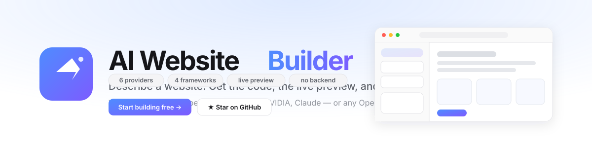

<div align="center">

<a href="https://lab1207.github.io/AI-Website-Builder/">
  
</a>

### Describe a website. Get the code, the live preview, and a finished project.

<p>
  <a href="https://lab1207.github.io/AI-Website-Builder/"><strong>Open the builder →</strong></a> ·
  <a href="https://github.com/lab1207/AI-Website-Builder">Source</a> ·
  <a href="https://github.com/lab1207/AI-Website-Builder/stargazers">Support us with a ⭐</a>
</p>

<p>


</p>
<p>


</p>

</div>

---

## What it does

Write a sentence. Get a working website.

```
A landing page for a specialty coffee brand called Ember,
with a dark hero, a three-column feature grid, and a contact form.
```

You get the files, a live preview you can click through, and a chat you can keep
refining in. No account, no backend, no build step on your machine.

**Bring your own model.** It works with any of these, or any endpoint that speaks
the OpenAI protocol:

| Provider | Key prefix | Notes |
|---|---|---|
|  `AIza…` | free tier available |
|  `sk-…` | uses your platform credits |
|  `sk-or-…` | one key, every model |
|  `nvapi-…` | free developer credits |
|  `sk-ant-…` | Claude Code style keys |
| `Any endpoint` | — | OpenAI-compatible, paste the base URL |

Keys are stored **per provider** in your own browser, so switching between
Gemini and Claude never means retyping them nothing reaches any server of ours,
because there are no servers.

---

## 📸 Preview


---

## ✨ Features

| | |
|---|---|
| **Prompt to website** | Describe it in plain English, with or without a reference image. |
| **Six providers** | Google Gemini, OpenAI, OpenRouter, NVIDIA NIM, Anthropic Claude, or a custom OpenAI-compatible endpoint. |
| **Live preview** | Renders as the code is written, in desktop, tablet, and mobile widths. |
| **Conversational editing** | Keep refining in the same thread. The model sees your current files. |
| **Point and change** | Click a spot in the preview and say what should be different there. |
| **Framework choice** | Plain HTML and CSS, React, Vue, or Next.js. |
| **Plain CSS or Tailwind** | Pick the styling output you want. |
| **Version history** | Every generation is saved, and any version can be restored. |
| **Explain the code** | Ask for a walkthrough of what the project does. |
| **Auto fix** | Let the model hunt for bugs, broken links, and layout problems. |
| **Edit the code** | Change any file by hand in the built-in editor. |
| **Asset editor** | Find every image, link, and button label and replace it in place. |
| **Import** | Bring in a `.zip` or `.html` and keep editing it with AI. |
| **Figma import** | Pull frames from a Figma file and use them as design references. |
| **Publish** | Download a ZIP, push to GitHub, or deploy to Vercel. |

---

## 🔄 How a request flows

```text
             pick your provider and key
                       │
                       ▼
            describe the website
                       │
      ┌────────────────┴────────────────┐
      ▼         ▼            ▼          ▼
   Gemini    OpenAI     OpenRouter   Claude
      └────────────────┬────────────────┘
                       ▼
      generate HTML • CSS • JavaScript
                       │
                       ▼
                 live preview
                       │
        ┌──────────────┴──────────────┐
        ▼                             ▼
  refine with chat          export, push, deploy
```

Everything runs in your browser. The only network call is the one you trigger by
sending a prompt, and it goes to the provider you picked.

---

## 🔑 Getting started

Clone the repository

```bash
git clone https://github.com/lab1207/AI-Website-Builder.git
cd AI-Website-Builder
npm install
npm run dev
```

Open <http://localhost:3000>. In **Settings**, pick a provider and paste that
provider's key. The model list is read from your key, so the picker only offers
models this account can actually use.

| Provider | Where to get a key |
|---|---|
| Google Gemini | [aistudio.google.com/app/apikey](https://aistudio.google.com/app/apikey) |
| OpenAI | [platform.openai.com/api-keys](https://platform.openai.com/api-keys) |
| OpenRouter | [openrouter.ai/keys](https://openrouter.ai/keys) |
| NVIDIA NIM | [build.nvidia.com/settings/api-keys](https://build.nvidia.com/settings/api-keys) |
| Anthropic | [console.anthropic.com/settings/keys](https://console.anthropic.com/settings/keys) |
| Custom | your endpoint's docs |

Keys stay in your browser and are sent only to the provider you chose.

> **Self-hosting with a key baked in:** setting `VITE_GEMINI_API_KEY` at build
> time puts that key in the published bundle, so anyone who opens the site can
> read it. Only do that for a deployment you control. It applies to Gemini only;
> other providers always need a visitor-supplied key.

---

## 📦 Publishing

| Target | How |
|---|---|
| **ZIP** | Export → Download ZIP. Every file, separated. |
| **GitHub** | Publish → GitHub. Needs a personal access token with the `repo` scope. |
| **Vercel** | Publish → Vercel. Needs a Vercel token. Produces a live URL. |
| **Anywhere else** | The build output in `dist/` is plain static files. |

Framework projects are exported with the files they need to run: `package.json`,
a Vite config, and an entry point, so `npm install && npm run dev` works
straight away.

---

## 🚀 Deployment

The build output is a plain static folder. It runs anywhere that can serve
files.

- **Vercel** — import the repository. `vercel.json` is included.
- **Cloudflare Pages** — connect the repository, build with `npm run build`, publish `dist`. `public/_headers` is included.
- **Netlify** — connect the repository. `netlify.toml` is included.
- **GitHub Pages** — push to `main` and the included workflow builds and deploys. Set **Settings → Pages → Source** to **GitHub Actions**.

Security headers ship in `public/_headers`, `vercel.json`, and `netlify.toml`,
and a test fails the build if the three ever drift apart. GitHub Pages cannot
send custom headers, so the same policy is also declared as a `<meta>` tag.

The build uses a relative Vite base, so it also works under a repository
subpath.

---

## 🛠 Stack

React · TypeScript · Vite · Tailwind CSS 4 · Vitest

Everything is bundled from this repository. The app makes **no third-party
requests** at startup: those belong to the provider call you trigger, and to the
Font Awesome and Inter fonts served locally.

---

## 📂 Layout

```text
src/
├── components/       # Header, chat, composer, preview, panels
│   ├── AppHeader.tsx      top bar, project name, star CTA
│   ├── ChatPanel.tsx      conversation, instructions, thinking mode
│   ├── Composer.tsx       prompt input, attachments, annotations
│   ├── PreviewPane.tsx    preview, code, and asset tabs
│   ├── SettingsPanel.tsx  provider, key, model, project controls
│   ├── HistoryPanel.tsx   versions and restore
│   └── PublishPanel.tsx   download, GitHub, Vercel, Figma
├── hooks/
│   └── useProvider.ts     provider + key state
├── lib/              # pure logic, covered by tests
│   ├── apiKey.ts         per-provider key storage
│   ├── providers.ts      provider catalogue and the send layer
│   ├── preview.ts        preview bundling and the storage shim
│   ├── projectTypes.ts   vanilla, React, Vue, Next.js
│   ├── publish.ts        GitHub, Vercel, Figma
│   └── versionHistory.ts snapshots, diff, restore
├── services/
│   └── geminiService.ts  Gemini SDK call and file parsing
├── styles.css
├── types.ts
├── App.tsx
└── main.tsx
```

---

## 🧪 Testing

```bash
npm run check
```

TypeScript, the Vitest suite, and a production build.

---

## 🗺 Roadmap

- [x] Multi-file website generation
- [x] Sandboxed, isolated preview
- [x] Project import and export
- [x] In-browser code editing
- [x] Version history with restore
- [x] Tailwind CSS output
- [x] React, Vue, and Next.js projects
- [x] Live model list per provider
- [x] GitHub push and Vercel deploy
- [x] Figma import
- [x] AI code explanations
- [x] Google Gemini, OpenAI, OpenRouter, NVIDIA, and Anthropic providers
- [x] A custom OpenAI-compatible endpoint
- [ ] Live preview for framework projects, without a local build
- [ ] Multi-page sites
- [ ] Project version diffing
- [ ] Custom domains

---

## 🤝 Contributing

See [CONTRIBUTING.md](CONTRIBUTING.md).

## 📄 License

[GPL-3.0-or-later](LICENSE). Free to use, study, change, and share. If you
distribute a modified version, you must share its source under the same
license.
