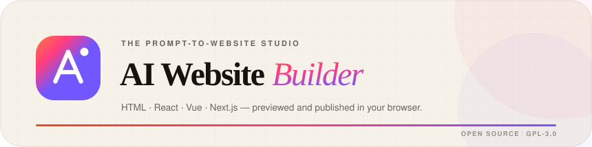
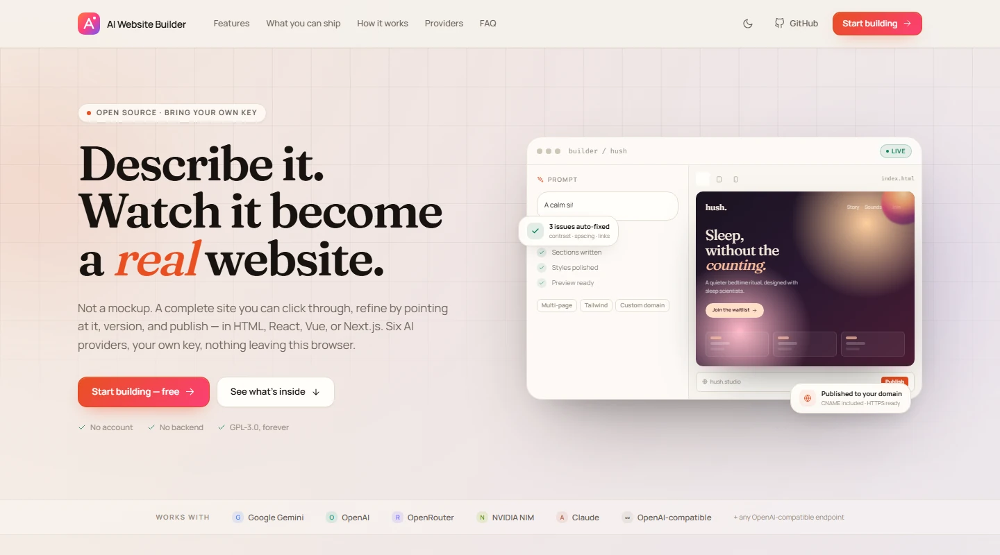
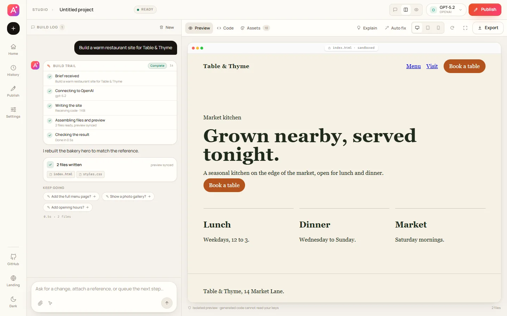
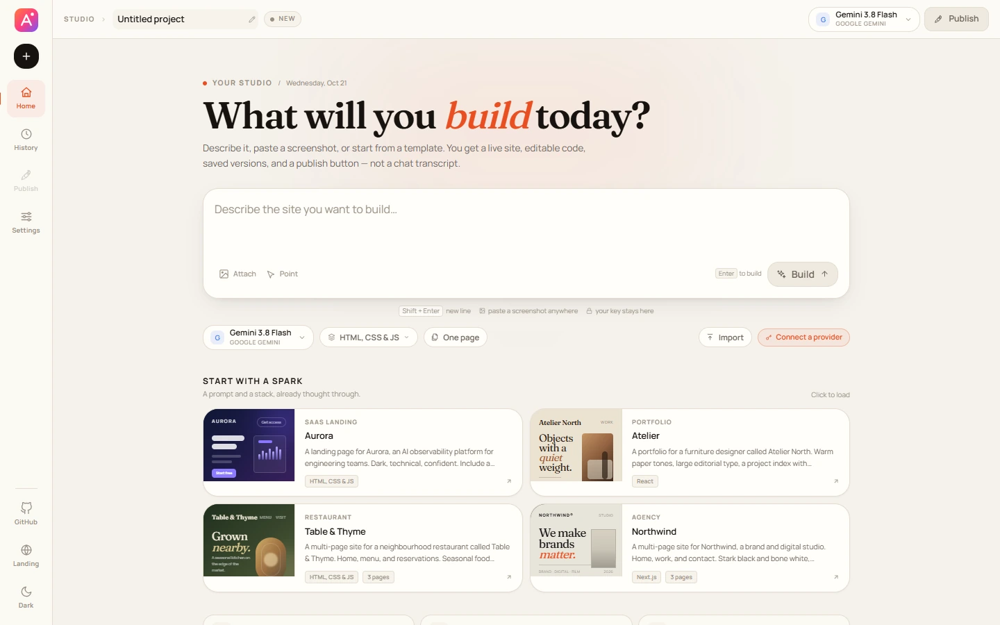

<div align="center">

<a href="https://ai-website-builder-7lq.pages.dev/">
  
</a>

### The source-to-website studio that stays in your browser.

Screenshot, live URL, existing code, a project file, or one sentence. It becomes a real<br />
website you can refine in conversation — then export or publish without leaving the tab.

<p>
  <a href="https://ai-website-builder-7lq.pages.dev/"><strong>Start building →</strong></a>
  &nbsp;·&nbsp;
  <a href="CHANGELOG.md">Release notes</a>
  &nbsp;·&nbsp;
  <a href="https://github.com/lab1207/AI-Website-Builder/issues">Report an issue</a>
</p>

<p>
  <a href="https://github.com/lab1207/AI-Website-Builder/actions/workflows/ci.yml">
    
  </a>
  
  
  
</p>

</div>

<a href="https://ai-website-builder-7lq.pages.dev/">
  
</a>

<p align="center"><sub><em>The landing page, at 1440px. Open source, bring your own key, no account.</em></sub></p>

---

## 01 · The short version

Most AI site builders stop at a chat transcript. This one keeps going.

Bring the source you already have — a screenshot, a live page, a folder of code, or a sentence. The model returns complete files, the studio turns them into a live, clickable preview, and the build trail shows every real stage while it works. You can keep talking mid-build: extra instructions queue instead of bouncing, and each finished build offers concrete next steps. Point at anything, edit the code or the design tokens, keep every version, then export it, push it to GitHub, deploy it to Vercel, or run the one-command Cloudflare deploy.

> **A real website is a set of files you can click through, edit, version, export, and host anywhere.**
> That is what this builds — not a mockup, and not a lock-in.

| The source | The build | The finish |
| :--- | :--- | :--- |
| Screenshot or image upload | Six AI provider options, including any OpenAI-compatible endpoint | ZIP of the full source, ready to host anywhere |
| Live URL capture (screenshot + page text) | HTML/CSS/JS, React, Vue 3, and Next.js projects | GitHub publishing with commits and best-effort Pages setup |
| Code, text, and config files | Single-page or linked multi-page sites | One-click Vercel deployment |
| `.zip` or `.html` project import | Live preview on desktop, tablet, and phone widths | Cloudflare Pages direct-upload command, ready to run |
| A sentence, or nothing but a name | Point-and-edit, colour and token editing, code view | DNS records and a `CNAME` file for four hosts |

<a href="https://ai-website-builder-7lq.pages.dev/">
  
</a>

<p align="center"><sub><em>A five-file, three-page project: live preview tabs, model controls, and export in one workspace.</em></sub></p>

## 02 · What a build actually includes

### Faithful to the source, honest about the process

When you supply a screenshot, a captured URL, existing code, or a design file, that source is ground truth: the prompt asks for the real section order, type scale, colours, spacing, imagery, and visible copy — not an approximation. A URL is captured as a screenshot plus readable page text using two small public services (`image.thum.io`, with Microlink as a fallback, and `r.jina.ai`); they see the address you enter, and a failed capture always says why instead of looping.

While the model works, the build log shows the real stages — brief received, connecting to the provider, writing the site, assembling files — with live details and elapsed time. There is no fake fill-and-reset progress bar. If a key is rejected, a rate limit is hit, a response is empty, output is cut off at the token limit, or the stream goes idle, you get the exact reason in plain language. Queued instructions pause after a failure rather than hammering the provider.

### Talk to it while it builds

Send another instruction mid-build and it joins a visible queue instead of being rejected; the queue runs one prompt at a time when the current build finishes, and you can remove items, clear it, or pause and resume it. A finished build can offer up to three clickable next steps, and if a decision would genuinely change the whole site, the model asks before guessing.

### The whole site, not a single screen

Vanilla projects can be **single-page or multi-page**. In multi-page mode the model is instructed to write real pages, link them together, and share the stylesheet and scripts. The preview notices those pages, gives each one a tab, and intercepts links inside the iframe so navigation stays in the preview instead of escaping it.

### Framework previews without a local build

Choose React, Vue 3, or Next.js and the export is a runnable Vite or Next project: `package.json`, entry point, config, and the generated components. Alongside that source, the model writes a self-contained `preview.html` — a faithful static rendering you can inspect in the studio without installing anything.

The preview is the design proof. The export is the real framework project.

### Edit by pointing

Annotation mode turns a click in the preview into precise context for the next prompt. Chat edits, whole-page regenerations, code edits, and the asset panel all work against the same project. Explain and Auto fix ask the model to reason about the current files.

### Versions that can be read

Every generation is snapshotted locally, up to 30 versions. Open history to see a real line diff — additions in green, removals in red, line numbers on both sides — then restore any snapshot without losing the current one.

### Publishing without ceremony

- **Download** a ZIP with every source file and an optional `CNAME`.
- **GitHub** creates or updates the repository, commits the complete tree, and asks Pages to serve it.
- **Vercel** deploys the project with your token and returns the live URL.
- **Cloudflare** prepares a Pages direct upload. Cloudflare's API sends no browser CORS headers, so instead of pretending a hidden request succeeded, the panel hands you the two exact `wrangler pages` commands and the direct-upload guide — and explains how to connect the repository for automatic deploys.
- **Domain** generates the exact A, CNAME, or ALIAS records for GitHub Pages, Vercel, Netlify, or Cloudflare Pages, and writes the `CNAME` file into the project.

The studio does not pretend to control your registrar. The domain sheet gives you the records; the DNS change is yours.

### Import, paste, capture, continue

Drop in a `.zip` or a single `.html` file and keep editing it with AI. Paste a screenshot straight into the composer, attach HTML, CSS, JS, Vue, Markdown, JSON, or SVG files, or paste a live URL to capture it as a screenshot plus page text. Import a Figma file with a personal token to pull its frames in as design references. Attachments alone are a valid prompt: send a screenshot with no words and the studio writes the rebuild instruction for you.

## 03 · Six provider options, one studio

| Provider | What you need | Model list |
| :--- | :--- | :--- |
| **Google Gemini** | [Gemini API key](https://aistudio.google.com/app/apikey) | Read live from the key; curated fallback if the list cannot be read |
| **OpenAI** | [OpenAI API key](https://platform.openai.com/api-keys) | Read live from the key |
| **OpenRouter** | [OpenRouter key](https://openrouter.ai/keys) | Read live, including the free and paid catalogue |
| **NVIDIA NIM** | [NVIDIA API key](https://build.nvidia.com/) | Read live from the key |
| **Anthropic Claude** | [Anthropic API key](https://console.anthropic.com/settings/keys) | Read live from the key |
| **OpenAI-compatible** | Base URL + key | Read from `/models` when the endpoint exposes it |

Open **Settings** to add a key. The model picker then loads the list that key can actually use and makes it searchable. If a provider cannot list models, the studio falls back to a small curated list and says so rather than silently pretending it refreshed.

Keys are stored one per provider in this browser. Switching from Gemini to Claude and back does not lose either key.

Settings also has a **Test connection** button that sends a real one-token request to the selected provider and model, so a key that can list models but has no credits is caught before a build. **Thinking mode** is on by default for models that support it, and can be switched off there.

<a href="https://ai-website-builder-7lq.pages.dev/">
  
</a>

<p align="center"><sub><em>The home screen: one prompt, the stack, a provider, and four deliberately art-directed starting points.</em></sub></p>

## 04 · The details that make it a studio

- **A real workspace.** Rail navigation, project status, view switcher, device widths, preview tabs, a collapsible conversation, and sheets for history, settings, publishing, and domains.
- **A model picker that behaves like one.** Grouped by provider, searchable, with the active model and provider always visible in the top bar.
- **Consistent by construction.** One set of tokens for warm paper, ink, ember, pink, and violet; Fraunces, Manrope, and Fira Code self-hosted; custom SVG icons; the same radii, spacing, focus states, and motion in both themes.
- **States, not surprises.** Loading shimmers, streaming text, disabled-action styling, inline validation, toasts with a dismiss action, and confirmations for destructive work.
- **A phone is not an afterthought.** The workspace becomes a drawer, a bottom tab bar, and a full-width preview; the landing page has its own mobile composition and keeps the sticky header.
- **A landing page you can return to.** The site remembers that you have visited the studio, so the logo and the Landing control take you home without losing the project.
- **No hidden cloud.** The studio is a static SPA. There is no account system, no database, no proxy, and no analytics.

## 05 · Run it locally

Requirements: **Node.js 22.12 or newer** and npm.

```bash
git clone https://github.com/lab1207/AI-Website-Builder.git
cd AI-Website-Builder
npm install
npm run dev
```

Open the printed local URL, choose a provider in **Settings**, and paste your own API key. Nothing needs to be configured to start.

### Scripts

| Command | What it does |
| :--- | :--- |
| `npm run dev` | Vite development server with HMR |
| `npm run typecheck` | TypeScript, no emit |
| `npm test` | 120 unit tests across providers, error handling, reference capture, the parser, keys, preview, domains, history, scaffolds, and secret scanning |
| `npm run build` | Typecheck, then a production build in `dist/` |
| `npm run preview` | Serve the production build locally |
| `npm run check` | Typecheck, test, and build in one pass |

### Optional environment

Copy `.env.example` to `.env.local` only if you need one of these:

```bash
# The absolute URL used for canonical, Open Graph, and Twitter tags.
# Cloudflare Pages supplies this in CI. Set it for a custom domain.
VITE_SITE_URL=https://your-domain.example

# Optional fallback for private deployments only.
# This key is bundled into the JavaScript and is readable by every visitor.
VITE_GEMINI_API_KEY=
```

### Deploy the studio

`npm run build` produces a static `dist/` folder. The repository ships with:

- a Cloudflare Pages workflow that builds, tests, and deploys on every push to `main`;
- `netlify.toml` for Netlify;
- `vercel.json` for Vercel;
- `public/_headers` with the same CSP and security headers used by the header configs.

The social image and canonical URL are filled from `VITE_SITE_URL` at build time. `vite.config.ts` also detects Vercel, Netlify, and Cloudflare Pages URLs automatically, and falls back to `https://ai-website-builder-7lq.pages.dev`.

### Deploy to Cloudflare Pages

The live studio is <https://ai-website-builder-7lq.pages.dev/>. The Cloudflare Pages project is named `ai-website-builder` and serves the `ai-website-builder-7lq.pages.dev` domain.

1. In the Cloudflare dashboard open **Workers & Pages → ai-website-builder → Settings → Builds**.
2. Set **Git repository** to `lab1207/AI-Website-Builder`, production branch `main`, build command `npm run build`, output directory `dist`, root directory blank. If the panel warns that the project is disconnected from your Git account, reinstall the "Cloudflare Workers and Pages" GitHub App and reconnect it.
3. Set `VITE_SITE_URL` to `https://ai-website-builder-7lq.pages.dev` under **Settings → Environment variables → Production**, so the canonical and social tags are deterministic. Point it at your custom domain instead if you attach one.
4. Deploy. Every push to `main` now builds and publishes automatically.

The v3 build image ships Node.js 22.16.0 and `.nvmrc` pins the major version to `22`, so no `NODE_VERSION` override is needed.

`public/_headers` is copied to `dist/_headers` and applies the CSP, security headers, and caching rules on Cloudflare Pages.

`.github/workflows/deploy-cloudflare.yml` is a CI alternative that deploys with Wrangler instead. It is off by default; turn it on by setting the repository variable `CLOUDFLARE_PAGES_DEPLOY` to `true` and adding the `CLOUDFLARE_API_TOKEN` (Cloudflare Pages: Edit) and `CLOUDFLARE_ACCOUNT_ID` secrets. Use one path or the other, not both.

## 06 · Privacy and security, plainly

- **Your key is yours.** It is stored in this browser's `localStorage`, per provider, and sent directly to that provider. There is no proxy and no server of ours to leak it. Clearing the key in Settings removes it. Local storage is not encrypted, so use a scoped or revocable key on a shared machine.
- **Publishing tokens do not persist.** GitHub, Vercel, and Figma tokens live in component memory and disappear when the sheet closes or the page reloads.
- **Generated code is isolated.** The preview runs in a sandboxed iframe without `allow-same-origin`. It cannot reach the studio's window, storage, or keys. A tiny storage shim keeps generated sites that use `localStorage` working.
- **No key is committed.** A test scans the tracked tree for provider-key shapes on every CI run, and the repository includes a `SECURITY.md` with the reporting process.
- **No third-party scripts in the studio.** Fonts and icons ship with the app. The only network calls at runtime are the ones your keys and actions trigger: model listing, generation, and publishing. External images in a generated preview are the generated site's own choice.
- **A tight Content-Security-Policy** is sent by every supported host as a response header, and mirrored in a meta tag so the page stays locked down even on a host that cannot set custom headers.

Read [SECURITY.md](SECURITY.md) for the full policy.

## 07 · How it is built

A static React app with no server-side component.

```text
src/
├─ components/        the landing page, studio shell, preview, panels, and primitives
├─ hooks/useProvider  provider and model state
├─ lib/
│  ├─ apiKey.ts       per-provider key storage and validation
│  ├─ domains.ts      DNS guides, host records, and CNAME files
│  ├─ generation.ts   the system prompt, the __FILE: parser, and __NEXT suggestions
│  ├─ preview.ts      preview document, page discovery, and the navigation bridge
│  ├─ projectTypes.ts framework scaffolds and stack instructions
│  ├─ providers.ts    six provider adapters, model loading, chat, and connection tests
│  ├─ publish.ts      GitHub, Vercel, and Figma APIs
│  ├─ reference.ts    URL capture: screenshot fallback chain and page text
│  └─ versionHistory.ts snapshots, restore, and the line diff
├─ services/geminiService.ts  the Gemini SDK adapter
├─ App.tsx
└─ styles.css         tokens, themes, and the design system
```

**Stack:** React 19, TypeScript, Vite 8, Tailwind CSS 4, and the Google Gen AI SDK. Fraunces, Manrope, and Fira Code are self-hosted. There is no component library and no icon font.

**Performance:** the initial application JavaScript is about 140 kB gzipped. JSZip and the Gemini SDK are separate chunks loaded only when you import a ZIP or start a Gemini generation.

**Testing:** 120 unit tests cover the parser and `__NEXT` suggestions, provider error handling and connection tests, the reference-capture fallback chain, key handling, the preview bridge, page discovery, scaffolds, DNS records, line diffs, config parity, and secret scanning. `npm run check` is the same gate CI uses.

## 08 · Release 3.1.0

This is the source-to-site release: rebuild from a screenshot, a live URL, code, a project file, or a sentence; a real staged build trail instead of a looping animation; a visible prompt queue with pause and resume; clickable follow-up suggestions; explicit provider, rate-limit, empty-response, and token-limit errors; a settings connection test; thinking mode on by default; colour and design-token editing in the Assets panel; and a Cloudflare Pages deploy path alongside Vercel.

Read the full [CHANGELOG](CHANGELOG.md).

## 09 · License

[GPL-3.0-or-later](LICENSE). You can use, study, share, and modify it; derivative distributions must remain under the same license. There is no warranty.

Contributions are welcome — start with [CONTRIBUTING.md](CONTRIBUTING.md) and the [Code of Conduct](CODE_OF_CONDUCT.md).

**Acknowledgements:** the source-fidelity prompting and screenshot-intake approach were informed by [abi/screenshot-to-code](https://github.com/abi/screenshot-to-code) (MIT). This project is an independent browser-only implementation and shares no code or backend with it.

---

<div align="center">
  <sub>Made for the web, in the browser.</sub>
</div>
