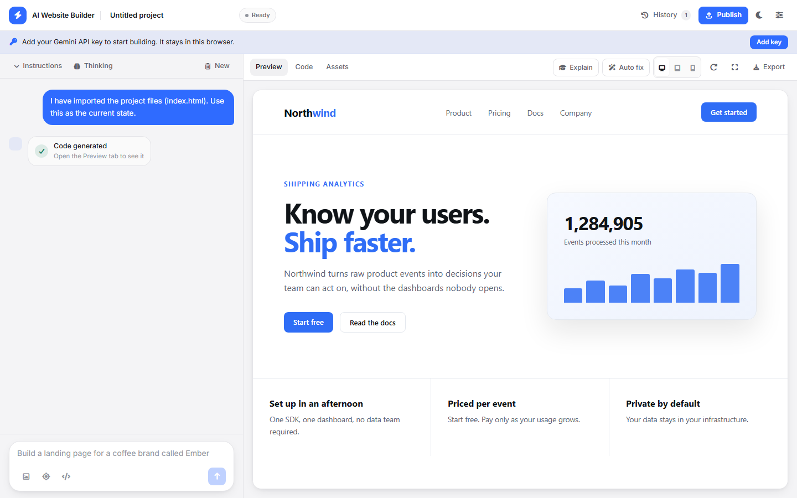

<div align="center">

# ⚡ AI Website Builder

### Describe a website. Get the code, the live preview, and a finished project.

<p>


<a href="https://github.com/lab1207/AI-Website-Builder/stargazers"></a>

</p>

<p>
  <a href="#what-it-does">What it does</a> •
  <a href="#-features">Features</a> •
  <a href="#-getting-started">Getting started</a> •
  <a href="#-publishing">Publishing</a> •
  <a href="#-deployment">Deployment</a> •
  <a href="#-roadmap">Roadmap</a>
</p>

</div>

---

## What it does

Write a sentence. Get a working website.

```
A landing page for a specialty coffee brand called Ember,
with a dark hero, a three-column feature grid, and a contact form.
```

You get the files, a live preview you can click through, and a chat you can
keep refining in. No account, no backend, no build step on your machine.

---

## 📸 Preview



---

## ✨ Features

| | |
|---|---|
| **Prompt to website** | Describe it in plain English, with or without a reference image. |
| **Live preview** | Renders as the code is written, in desktop, tablet, and mobile widths. |
| **Conversational editing** | Keep refining in the same thread. The model sees your current files. |
| **Point and change** | Click a spot in the preview and say what should be different there. |
| **Framework choice** | Plain HTML and CSS, React, Vue, or Next.js. |
| **Plain CSS or Tailwind** | Pick the styling output you want. |
| **Version history** | Every generation is saved, and any version can be restored. |
| **Explain the code** | Ask for a walkthrough of what the project does. |
| **Auto fix** | Let the model hunt for bugs, broken links, and layout problems. |
| **Edit the code** | Change any file by hand in the built-in editor. |
| **Asset editor** | Find every image, link, and button label and replace it in place. |
| **Import** | Bring in a `.zip` or `.html` and keep editing it with AI. |
| **Figma import** | Pull frames from a Figma file and use them as design references. |
| **Publish** | Download a ZIP, push to GitHub, or deploy to Vercel. |
| **Your key, your browser** | The API key is stored locally and sent only to Google. |

---

## 🚀 How it works

```text
              Describe your website
                       │
                       ▼
              Google Gemini AI
                       │
                       ▼
      Generate HTML • CSS • JavaScript
                       │
                       ▼
                Live preview
                       │
          ┌────────────┴────────────┐
          ▼                         ▼
   Refine with chat           Export, push, deploy
```

Everything runs in your browser. There is no server, no database, and no
account. The only network call is the one you trigger by sending a prompt.

---

## 🔑 Getting started

Clone the repository

```bash
git clone https://github.com/lab1207/AI-Website-Builder.git
cd AI-Website-Builder
npm install
npm run dev
```

Open <http://localhost:3000> and paste your Gemini API key into **Settings**.
Get a free key from [Google AI Studio](https://aistudio.google.com/app/apikey).

The key is stored in your browser's `localStorage` and sent only to
`generativelanguage.googleapis.com`. There is no `.env` file and no key is
ever committed.

> **Self-hosting with a key baked in:** set `VITE_GEMINI_API_KEY` at build time
> and the key is embedded in the published bundle, so anyone who opens the site
> can read it. Only do this for a deployment you control.

---

## 📦 Publishing

| Target | How |
|---|---|
| **ZIP** | Export → Download ZIP. Every file, separated. |
| **GitHub** | Publish → GitHub. Needs a personal access token with the `repo` scope. |
| **Vercel** | Publish → Vercel. Needs a Vercel token. Produces a live URL. |
| **Anywhere else** | The build output in `dist/` is plain static files. |

Framework projects are exported with the files they need to run: `package.json`,
a Vite config, and an entry point, so `npm install && npm run dev` works
straight away.

---

## 🚀 Deployment

The build output is a plain static folder. It runs anywhere that can serve
files.

- **Vercel** — import the repository. `vercel.json` is included.
- **Cloudflare Pages** — connect the repository, build with `npm run build`, publish `dist`. `public/_headers` is included.
- **Netlify** — connect the repository. `netlify.toml` is included.
- **GitHub Pages** — push to `main` and the included workflow builds and deploys. Set **Settings → Pages → Source** to **GitHub Actions**.

Security headers ship in `public/_headers`, `vercel.json`, and `netlify.toml`,
and a test fails the build if the three ever drift apart. GitHub Pages cannot
send custom headers, so the same policy is also declared as a `<meta>` tag.

The build uses a relative Vite base, so it also works under a repository
subpath.

---

## 🛠 Stack

React · TypeScript · Vite · Tailwind CSS 4 · Google Gemini · Vitest

Everything is bundled from this repository. The app makes **no third-party
requests** at runtime beyond the Gemini call you trigger.

---

## 📂 Layout

```text
src/
├── components/       # Header, chat, composer, preview, panels
├── hooks/            # API key storage
├── lib/              # Pure logic, covered by tests
│   ├── apiKey.ts
│   ├── preview.ts    # Preview bundling and the storage shim
│   ├── projectTypes.ts
│   ├── publish.ts    # GitHub, Vercel, Figma
│   └── versionHistory.ts
├── services/         # Gemini calls and file parsing
├── styles.css
├── types.ts
├── App.tsx
└── main.tsx
```

---

## 🧪 Testing

```bash
npm run check
```

TypeScript, the Vitest suite, and a production build.

---

## 🗺 Roadmap

- [x] Multi-file website generation
- [x] Sandboxed, isolated preview
- [x] Project import and export
- [x] In-browser code editing
- [x] Version history with restore
- [x] Tailwind CSS output
- [x] React, Vue, and Next.js projects
- [x] Live model list
- [x] GitHub push and Vercel deploy
- [x] Figma import
- [x] AI code explanations
- [ ] Live preview for framework projects, without a local build
- [ ] Multi-page sites
- [ ] Project version diffing
- [ ] Custom domains

---

## 🤝 Contributing

See [CONTRIBUTING.md](CONTRIBUTING.md).

## 📄 License

[GPL-3.0-or-later](LICENSE). Free to use, study, change, and share. If you
distribute a modified version, you must share its source under the same
license.
